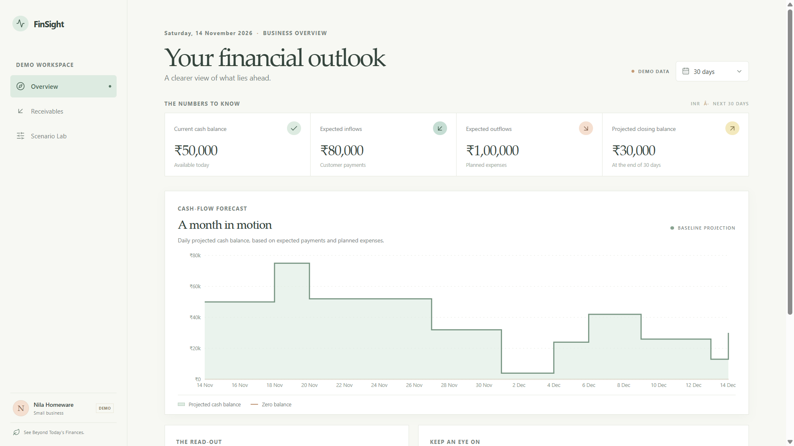
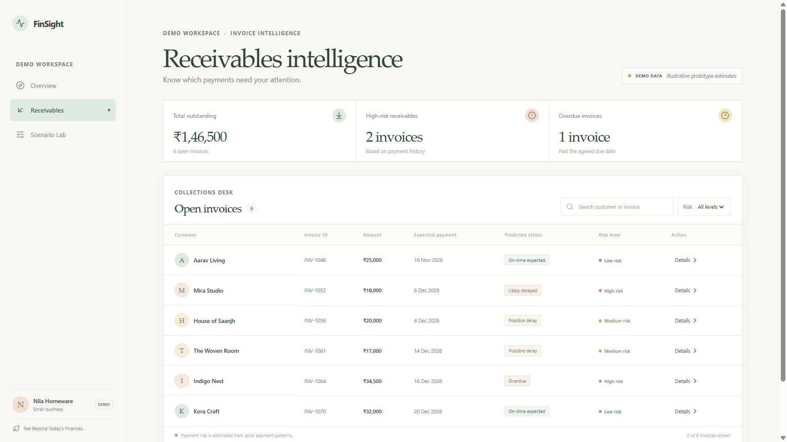
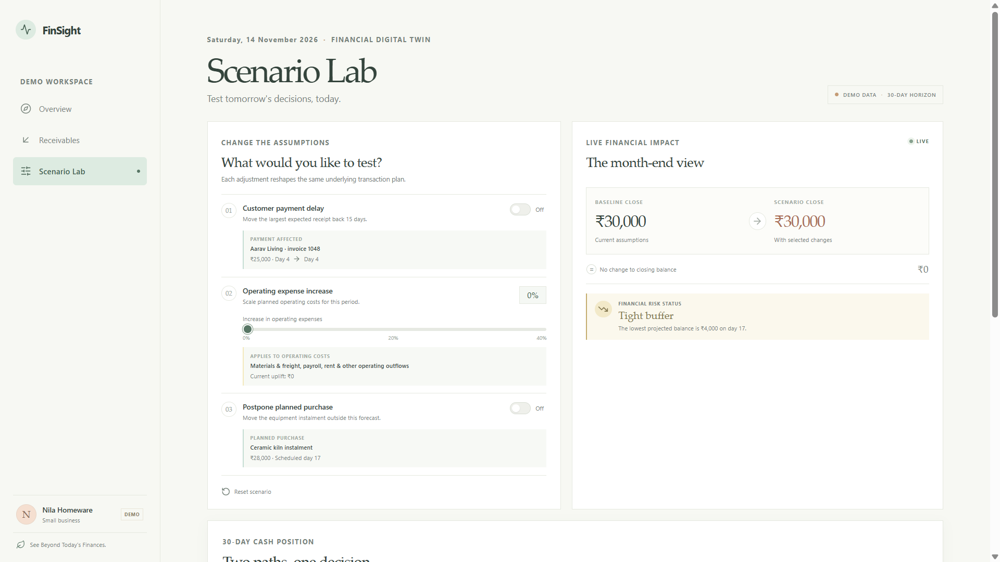

# FinSight

### See Beyond Today's Finances.

**AI-Powered Financial Intelligence & Digital Twin for MSMEs**

FinSight is a financial planning prototype that helps small businesses see how incoming payments and planned expenses may shape their cash position. Explore receivables, review a daily cash-flow projection, and test a few “what if” changes in an interactive scenario workspace.

    

> **Explore three views:** [Overview](#application-routes) · [Receivables](#application-routes) · [Scenario Lab](#application-routes)

---

## Overview

Micro, Small and Medium Enterprises (MSMEs) often make decisions with incomplete visibility into when customer payments will arrive and how upcoming costs affect available cash. FinSight brings a sample business’s invoices and scheduled transactions into one interface, helping business owners and operators reason about near-term liquidity.

The experience is organized around three pillars:

- **Predict** – Identify potential invoice payment delays from the sample customer payment histories.
- **Simulate** – See how selected timing and expense assumptions change the projected cash balance.
- **Recommend** – Surface risk cues and scenario read-outs to help focus attention on possible next steps.

## Application Preview

Screenshots below show the current FinSight demo experience.

### Financial Overview

Review cash balances, expected movements, the cash-flow forecast, and upcoming risks at a glance.

<p align="center">
  
</p>

### Receivables Intelligence

Search and filter open invoices, inspect payment-risk estimates, and review customer payment history.

<p align="center">
  
</p>

### Scenario Lab

Adjust cash-flow assumptions and compare the resulting projection with the baseline.

<p align="center">
  
</p>

## Problem Statement

MSMEs can face several connected financial pressures:

- Customer invoices may be paid later than their agreed due dates.
- Expenses such as materials, payroll, rent, and equipment purchases can vary or fall due at inconvenient times.
- A current account balance alone offers limited visibility into the cash needed over the coming weeks.
- Payment delays and clustered expenses can create unexpected liquidity shortages.
- Without a way to compare assumptions, it is difficult to understand the likely cash impact of a decision before making it.

## Our Solution

FinSight combines a receivables view with a transaction-based cash-flow projection and an interactive financial digital twin:

- **Invoice payment-risk intelligence** applies transparent rules to sample customer payment history to estimate risk and expected payment timing.
- **Cash-flow forecasting** recalculates a daily balance from the starting cash balance and scheduled inflows and outflows.
- **Financial digital twin** uses the same sample transaction plan as a baseline for exploring adjusted assumptions.
- **What-if simulation** models a delayed largest receipt, higher operating expenses, and a postponed planned purchase.
- **Financial recommendations and cues** are presented as rule-based risk indicators, alerts, and scenario explanations—not as individualized professional advice.

## Key Features

The following are implemented in the current prototype:

- **Financial overview dashboard** with current cash, expected inflows and outflows, projected closing balance, and an outlook summary.
- **Cash-flow forecasting** with daily projected balances and selectable 7-, 14-, or 30-day dashboard views.
- **Invoice payment-risk indicators** with low, medium, and high risk levels, estimated payment dates, overdue status, and explanations.
- **Receivables management** for reviewing open sample invoices, searching by customer or invoice ID, and filtering by risk.
- **Customer payment-risk insights** showing payment history, average delay, predicted delay, and the rule behind the risk label.
- **Interactive scenario simulation** with controls to delay the largest expected receipt by 15 days, increase operating outflows by 0–40%, or move a planned purchase beyond the 30-day window.
- **Baseline versus scenario comparison** with closing balances, projected daily cash paths, low-point and shortfall summaries, and a reset control.
- **Financial alerts and recommendations** in the form of upcoming risk items, action links, scenario read-outs, and generated invoice reminder text that users can copy.

### Implementation status

These features operate on fixed illustrative data for the demo business **Nila Homeware**. Invoice risk is estimated with hand-coded thresholds against the supplied payment history. The current project does not include a trained machine-learning model, live accounting or banking connections, a backend, or persistent business records. The interface labels predictions and scenarios as illustrative prototype outputs. Further integrations or predictive models should be treated as future work unless implemented separately.

## The Financial Digital Twin

The Scenario Lab is FinSight’s signature concept: a lightweight, interactive model of the demo business’s near-term cash position. It begins with a baseline built from the starting cash balance, expected invoice receipts, and planned expenses. Each adjustment recalculates the daily balance from that same transaction plan, then compares the selected scenario with the baseline.

In the current implementation, users can explore three assumptions:

1. Move the largest expected customer receipt back by 15 days.
2. Increase operating outflows by a chosen percentage, from 0% to 40%.
3. Postpone a planned equipment purchase until after the 30-day forecast.

The comparison shows how those assumptions affect the closing balance, the lowest balance during the horizon, and whether the modeled balance falls below zero. This is an illustrative decision-support model using bundled sample transactions; it does not connect to live books or automatically learn from business activity.

## Application Routes

Navigation is handled with URL hash routes:

| Route | View | What it contains |
| --- | --- | --- |
| `#overview` | Overview | Cash summary, forecast chart, outlook, upcoming risks, and quick links. This is the default route. |
| `#receivables` | Receivables | Searchable and filterable invoice list with risk estimates and invoice detail panel. |
| `#scenario-lab` | Scenario Lab | Scenario controls, baseline comparison, chart, and explanatory read-out. |

For example, while the development server is running, open `http://localhost:5173/#scenario-lab` to view the Scenario Lab.

## Technology Stack

- **React 19** for the interface and component model.
- **Vite 8** for local development and production builds.
- **JavaScript ES modules** for application logic.
- **Recharts** for cash-flow and scenario charts.
- **Lucide React** for interface icons.
- **CSS** in `src/styles/` for the responsive dashboard styling.

## Getting Started

### Prerequisites

- Node.js compatible with the installed Vite version.
- npm.

### Install and run

```bash
npm install
npm run dev
```

Vite prints the local URL in the terminal (typically `http://localhost:5173`). To create and serve a production build:

```bash
npm run build
npm run preview
```

## Project Structure

```text
.
├── index.html                 # Document metadata and application mount point
├── package.json               # Scripts and dependencies
├── vite.config.js             # Vite and React plugin configuration
└── src/
    ├── App.jsx                # Hash-based page selection
    ├── main.jsx               # React entry point
    ├── components/            # Shared navigation, cards, badges, and charts
    ├── data/demoData.js       # Nila Homeware sample invoices and transactions
    ├── pages/                 # Overview, Receivables, and Scenario Lab
    ├── styles/                # Global and dashboard styles
    └── utils/                 # Payment estimates, cash simulation, and formatting
```

## Data and Limitations

- All business, invoice, payment-history, cash, and expense values are bundled demo data defined in `src/data/demoData.js`.
- The payment-risk estimator uses explicit late-rate and average-delay thresholds in `src/utils/paymentPrediction.js`; it is not a trained or validated AI/ML model.
- Cash projections are deterministic calculations over the included scheduled events and selected scenario assumptions.
- Scenario changes and follow-up status are held in page state; there is no backend or durable storage in this project.
- Generated reminder text is a local draft for copying. The app does not send reminders or contact customers.
- Outputs are for demonstration and exploration, not audited forecasts or financial advice.

## Available Scripts

| Command | Description |
| --- | --- |
| `npm run dev` | Start the Vite development server. |
| `npm run build` | Build the production assets into `dist/`. |
| `npm run preview` | Serve the production build locally. |

---

*FinSight — See Beyond Today's Finances.*
