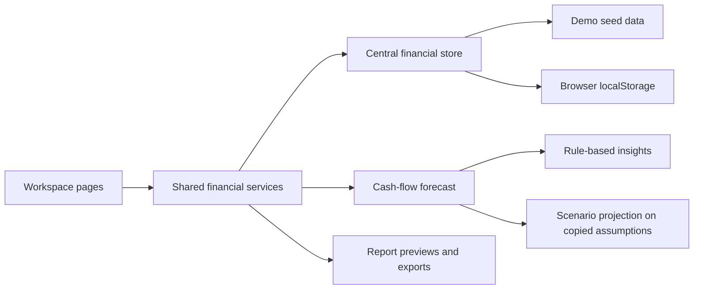
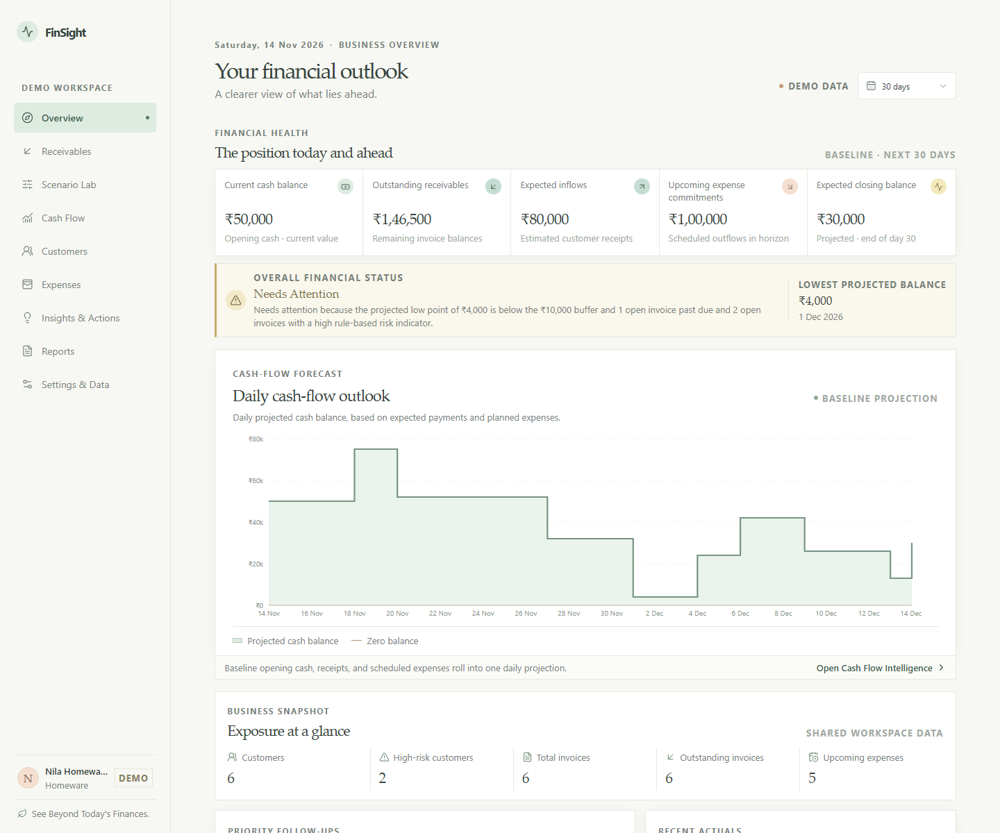
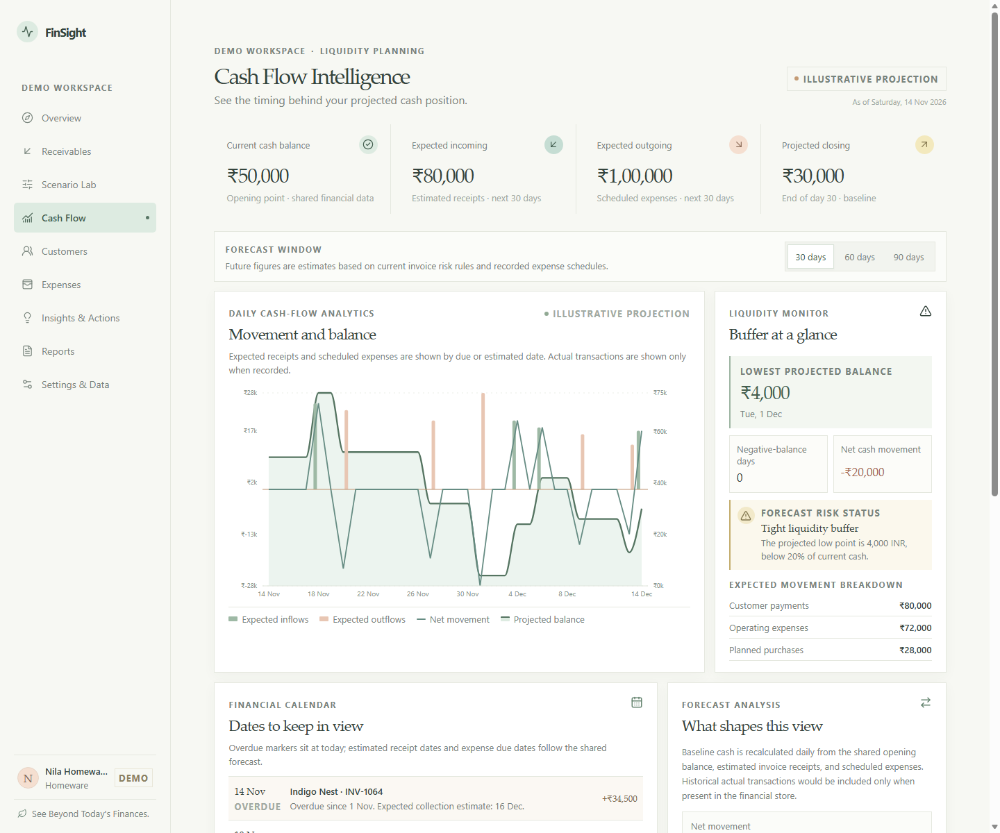
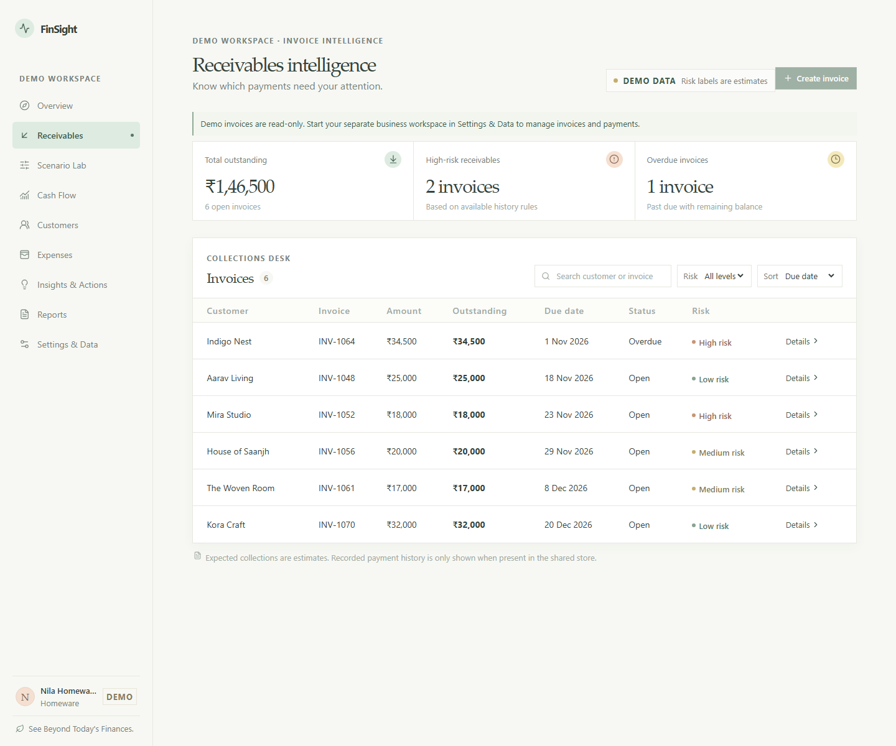
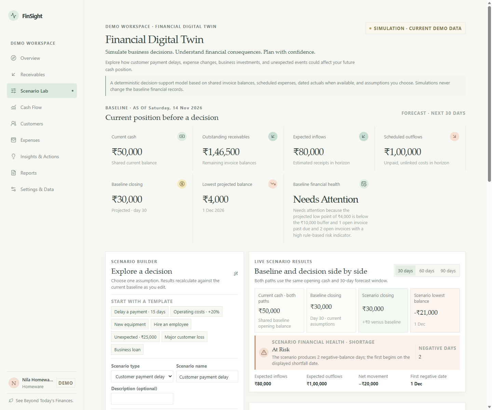

# FinSight

### See Beyond Today's Finances.

FinSight is a browser-based financial intelligence workspace for micro, small, and medium-sized businesses. It brings customer invoices, scheduled expenses, cash-flow forecasts, risk indicators, scenario simulations, and reports into one shared financial model.

> Prototype for decision support and demonstration. Forecasts and risk indicators are estimates; this application is not connected to bank or accounting feeds.

## The problem

Business owners often have records of what is owed and what is coming due, but limited visibility into how payment timing and scheduled costs affect near-term liquidity. A current balance by itself does not explain the cash position a few weeks from now.

## The solution

FinSight keeps customer, invoice, payment, expense, and transaction records in a shared browser workspace. Deterministic services calculate receivable balances, expense commitments, daily cash projections, customer indicators, insights, and scenario results. The Financial Digital Twin lets a user compare selected hypothetical assumptions with the baseline projection without changing the underlying records.

## Intended users

MSME owners and finance or operations staff who want a clear view of upcoming cash commitments and a lightweight way to explore possible decisions.

## Modules

- **Overview** — financial health summary, important alerts, performance snapshot, and shared forecast outlook.
- **Cash Flow Intelligence** — selectable 30, 60, and 90-day forecast, projected daily balances, movement analysis, and financial timeline.
- **Receivables** — invoice directory, linked balances and payments, rule-based risk indicators, and local reminder drafts.
- **Customer Intelligence** — customer exposure, invoice relationships, and available payment-history indicators.
- **Expense Intelligence** — scheduled commitments, category breakdowns, due dates, and supported payment status.
- **Scenario Lab / Financial Digital Twin** — create and compare hypothetical cash-flow assumptions against a baseline.
- **Insights & Actions** — traceable financial warnings, supporting figures, related records, and review status.
- **Reports** — previews and CSV/PDF exports across seven report categories.
- **Settings & Data** — workspace preferences, separate demo and user workspaces, CSV import, JSON backup/restore, and record exports.

## Financial Digital Twin

The Scenario Lab starts with the same cash-flow baseline used by the workspace and applies hypothetical assumptions to a copy of the projection inputs. Scenario examples include payment delays, expense changes, purchases, hiring, loans, customer loss, and unexpected expenses. Users can inspect differences in projected closing cash, low points, and shortage dates. Simulation results remain labeled as simulated and do not become actual transactions.

## Architecture



Application navigation uses URL hash routes. `src/App.jsx` selects the page, while shared data structures and storage live in `src/data/financialStore.js`, demo records in `src/data/demoData.js`, and reusable calculations in `src/utils/financialServices.js` and related utility modules.

## Technology

- React 19
- Vite 8
- JavaScript ES modules
- Recharts
- Lucide React
- Browser `localStorage` for local persistence
- Node.js built-in test runner

## Run locally

Requirements: a Node.js version compatible with Vite 8 and npm.

```bash
npm ci
npm run dev
```

Open the local URL printed by Vite. Production build and preview:

```bash
npm run build
npm run preview
```

Automated checks:

```bash
npm test
```

There is no environment file or API key required. The application has no backend; workspace data is stored in the current browser profile.

## Demo journey

Use the clearly labeled **DEMO WORKSPACE** to explore the existing example business without entering data. Demo records are read-only. To manage records, use **Settings & Data → Start your workspace**; the new user workspace starts separately and empty. Switch back to the demo from Settings at any time. See [the 5–7 minute demo walkthrough](docs/DEMO_WALKTHROUGH.md).

## Screenshots

These screenshots were captured from the running application using the sample workspace. The former preview images are retained separately in `screenshots/archive/`.

| Overview | Cash Flow Intelligence |
| --- | --- |
|  |  |

| Receivables | Financial Digital Twin |
| --- | --- |
|  |  |

Additional desktop captures are available for [Customers](screenshots/current/customers.png), [Expenses](screenshots/current/expenses.png), [Insights](screenshots/current/insights.png), [Reports](screenshots/current/reports.png), and [Settings](screenshots/current/settings.png). The [390px mobile Overview](screenshots/current/overview-mobile-390.png), [Expense page](screenshots/current/expenses-mobile-390.png), and [Expense table and controls](screenshots/current/expenses-table-mobile-390.png) captures show responsive layouts.

## Calculation and data transparency

- Invoice remaining balances equal the invoice amount less linked recorded payments; paid invoices contribute no outstanding receivable.
- Scheduled invoice receipts use open balances and the existing risk/timing rules. They are estimates, not confirmed payments.
- Expense schedules and dated actual transactions are incorporated through shared calculation services. Linked events are reconciled to avoid counting the same record twice.
- The bundled demo has no recorded payment records or dated actual transactions. Its historical cash activity is therefore unavailable; demo cash movement is a forward-looking illustration based on sample invoice due dates and expense schedules.
- Payment reliability and risk categories are deterministic rule-based indicators using supplied aggregate demo-history summaries and configured thresholds. There is no trained ML model, model accuracy claim, or automated learning.
- Scenario results use copied assumptions and do not alter historical records.
- Reports expose source availability and avoid fabricating missing historical activity. Display currency defaults to INR; currency conversion is not implemented.

## Project structure

```text
src/
  components/       Shared navigation, cards, charts, and timelines
  data/             Demo records and central financial store
  pages/            Overview and eight intelligence/workspace pages
  styles/           Global and module styles
  utils/            Financial calculations, simulation, reporting, formatting
tests/              Financial, reporting, scenario, and data-management tests
docs/               Demo walkthrough
screenshots/         Archived legacy captures; current captures pending
```

## Limitations and future work

- Data is local to one browser and is not synchronized, encrypted by the app, or shared between users/devices.
- There are no bank, accounting, email, or payment-processor integrations.
- Demo payment-history summaries are illustrative and distinct from recorded payments.
- Forecasts depend on the records and assumptions available in the workspace; they are not audited cash-flow statements or professional financial advice.
- A future production version could add secure multi-user storage, accounting integrations, verified transaction imports, and validated forecasting methods.

## Repository hygiene

Use `npm ci` to install exactly the versions in `package-lock.json`. Do not commit local `.env` files, browser data, credentials, `node_modules`, or temporary captures. Review the Git diff before submission; this workspace is not configured for automatic publishing.
